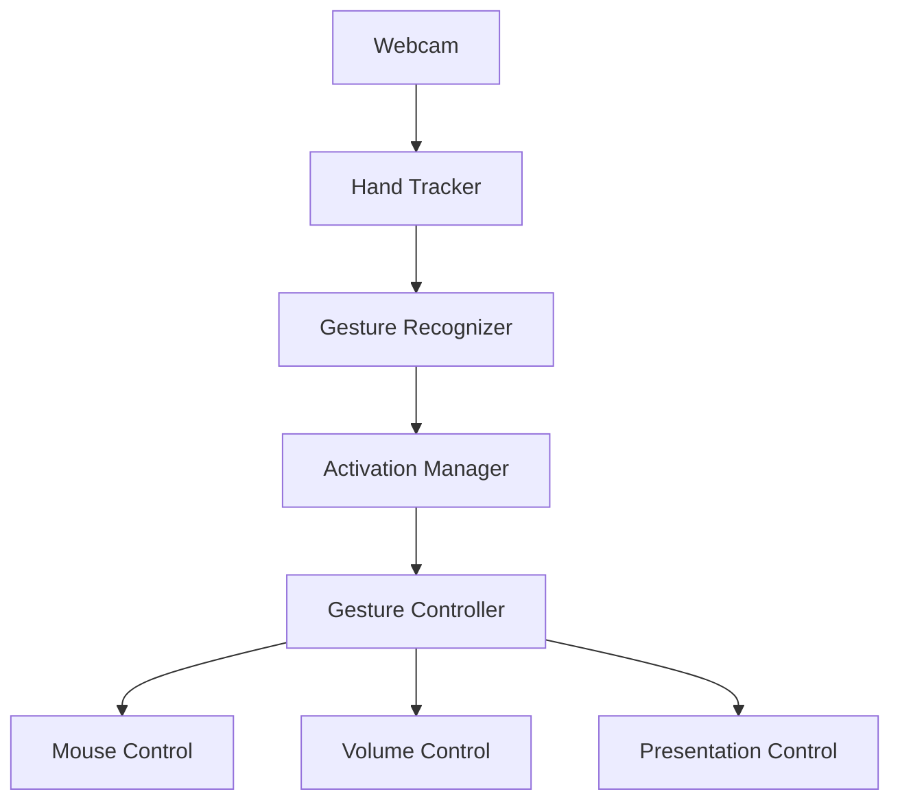

# 🖐️ Hand Gesture Control

Control your computer using nothing but your hand and a webcam.

[](https://www.python.org/)
[](https://opencv.org/)
[](https://mediapipe.dev/)
[](LICENSE)

A practical computer-vision project for touchless human-computer interaction. This repository contains two modes:

- a browser demo for safe local experimentation
- a desktop Python application for actual OS control with webcam-driven gestures

## Overview

The desktop system captures a live webcam feed, detects a hand using MediaPipe, recognizes a small gesture vocabulary, and dispatches actions such as cursor movement, clicks, volume modification, and presentation navigation. A deliberate activation state prevents accidental control by requiring an open palm hold before commands become active.

## Demo

The browser demo runs entirely in the browser and does not upload frames to a backend. It simulates actions such as cursor motion, volume changes, and slide control within the page to demonstrate the concept without requiring Python or OS-level control permissions.

## Features

- real-time hand landmark detection
- gesture recognition with thresholded geometric logic
- open-palm activation gate for safety
- smooth mouse cursor mapping
- system volume controls via platform-specific backends
- presentation slide navigation using keyboard events
- browser-only prototype with no server upload
- modular structure for clean extension and testing

## Gesture controls

| Gesture | Action |
| --- | --- |
| 👍 Thumbs Up | Volume Up |
| 👎 Thumbs Down | Volume Down |
| ✌️ Two Fingers | Next Slide |
| ☝️ One Finger | Previous Slide |
| 🖱️ Index Finger Movement | Move Cursor |
| 🤏 Pinch | Mouse Click |
| 🖐️ Open Palm | Activate / Safety Gesture |

## Architecture



## Tech stack

- Python 3.10+
- OpenCV
- MediaPipe
- NumPy
- PyAutoGUI
- JavaScript + browser MediaPipe
- pytest

## Repository structure

```text
hand-gesture-control/
├── README.md
├── LICENSE
├── .gitignore
├── requirements.txt
├── requirements-dev.txt
├── config.py
├── main.py
├── src/
│   ├── camera/
│   ├── controllers/
│   ├── safety/
│   ├── utils/
│   └── vision/
├── web/
│   ├── index.html
│   ├── styles.css
│   ├── app.js
│   └── assets/
├── tests/
├── docs/
├── screenshots/
├── .github/
└── .
```

## Installation

```bash
cd /workspaces/Hand-Gesture-Control
python3 -m venv .venv
source .venv/bin/activate
pip install -r requirements.txt
```

## Usage

### Desktop version

```bash
python main.py
```

Use the following gestures after activation:

- open palm for 1.5s to activate
- thumbs up/down for volume control
- two fingers for next slide
- one finger for previous slide
- pinch for click
- index fingertip movement for cursor control

### Web demo

Open the file in a browser:

```bash
cd /workspaces/Hand-Gesture-Control/web
python3 -m http.server 8000
```

Then visit:

```text
http://localhost:8000/
```

> Browser security prevents a normal web page from controlling the host OS mouse and keyboard, so the web demo simulates those interactions inside the page only.

## Configuration

Configuration values are centralized in `config.py` and include camera settings, activation hold time, gesture thresholds, cursor smoothing, pinch threshold, and key mappings.

## Web demo limitations

- cannot control real OS mouse or keyboard
- cannot raise or lower host system volume
- cannot directly drive external presentation software
- only simulates those effects in-browser

## Desktop version

The desktop version runs locally and uses the webcam to control cursor movement, slide navigation, and system volume on supported platforms.

## Supported operating systems

The desktop version is designed to work best on:

- Linux
- macOS
- Windows (best effort; platform-specific backends may require additional setup)

The volume backend is isolated so it can be replaced by OS-specific logic if needed.

## Troubleshooting

Common camera and installation issues are documented in [docs/troubleshooting.md](docs/troubleshooting.md).

## Privacy

The project does not upload webcam frames to any backend. The browser demo processes frames locally in the browser, and the desktop version processes frames locally on the user's machine.

## Security

This project intentionally enforces an activation gesture before commands are accepted. The activation gate helps reduce accidental mouse movement, clicks, or volume changes.

## Future improvements

- multi-hand gestures
- custom gesture macros
- calibration tools
- voice + gesture hybrid control
- adaptive AI gesture recognition
- additional platform support for volume and automation

## Contributing

Contributions are welcome. Please keep the architecture clean, write tests for new logic, and document any new gestures or configuration values.

## License

This project is licensed under the MIT License. See [LICENSE](LICENSE) for details.

## Roadmap

- add custom gesture training
- support browser-based keyboard simulation in a controlled sandbox
- improve volume control for more Linux desktops and Windows setups
- add richer calibration and personalization
