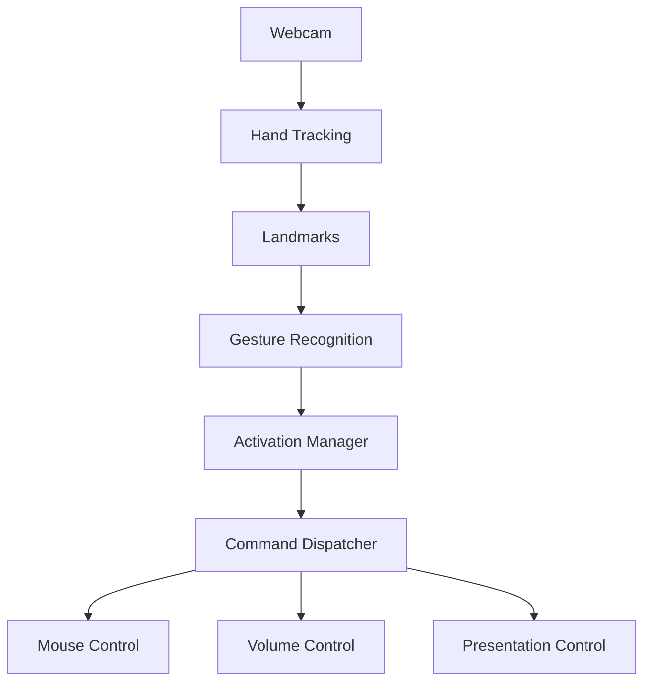

# Architecture

## Overview

The project is split into three layers: perception, safety, and action.

## Data flow

1. `CameraManager` captures webcam frames.
2. `HandTracker` extracts 21 MediaPipe hand landmarks.
3. `GestureRecognizer` applies geometry-based checks to classify gestures.
4. `ActivationManager` enforces the open-palm hold requirement.
5. `GestureController` routes recognized gestures to the correct action layer.

## Components

- `CameraManager`: OpenCV capture wrapper.
- `HandTracker`: MediaPipe integration.
- `GestureRecognizer`: static and geometric gesture detection.
- `ActivationManager`: safe activation gating.
- `MouseController`: screen mapping + smoothing.
- `VolumeController`: system volume adjustments.
- `PresentationController`: keyboard-based slide navigation.

## Browser limitations

The browser version cannot directly control the OS mouse or keyboard, so it simulates the same interactions within the page. Camera processing remains local and is never uploaded.

## Desktop architecture

The desktop version runs locally. It respects the activation state, applies cooldowns, and prevents accidental commands while inactive.
